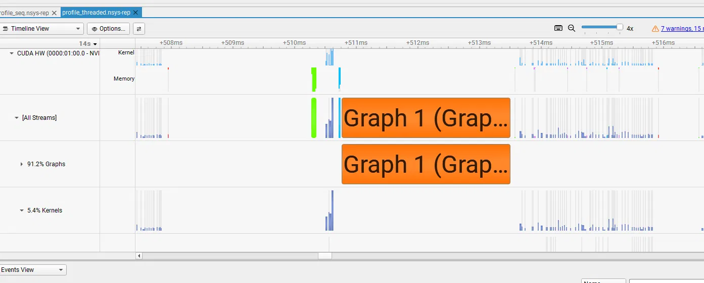
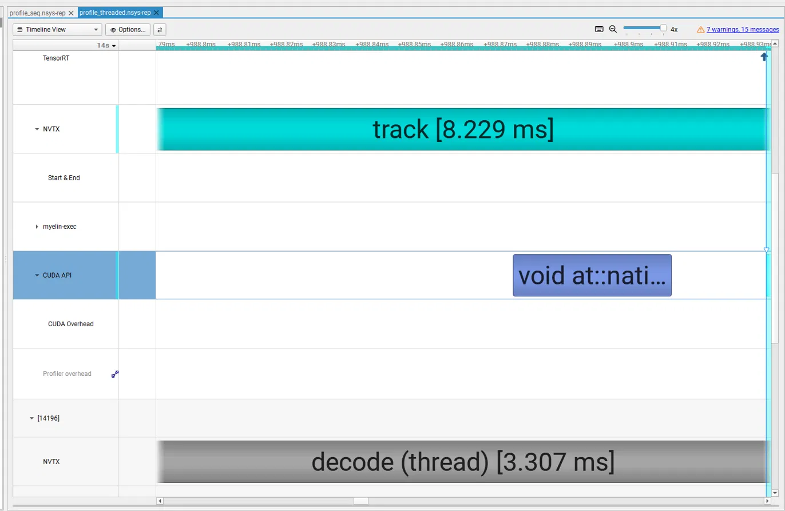

# Game Object Tracking

Multi-object tracking on gameplay recordings: detect characters in every frame, keep a stable ID on each one over time, and make the pipeline fast on the GPU without losing accuracy.

Follow-up to [realtime-depth-optimization](https://github.com/karadjordjepetrovic/realtime-depth-optimization) and game-text-recognition (HUD mask).

## Summary

On a 41-second 1080p gameplay clip, on an RTX 3070:

- **8× faster than the reference run (15.8 → 126.5 FPS)** while matching PyTorch YOLO11m's agreement with the reference (F1 0.81, IDF1 0.74).
- **TensorRT FP16:** network 3.8× faster, whole pipeline 2× faster (47 → 92 FPS), accuracy unchanged.
- **Threaded decode:** +37% (92 → 126.5 FPS) by overlapping video decoding with inference, results identical.
- **Two optimizations that did not pay off,** each traced to its cause with profiling: NMS inside the TensorRT engine (slower, and it silently dropped the low-confidence detections ByteTrack relies on), and GPU preprocessing (correct, but its saving was absorbed by framework overhead).
- **Where the time goes now:** the GPU computes ~3 ms of each ~7.9 ms frame. The rest is per-frame Python work in the detection framework and the tracker, which is the next target.

Raw evidence for every number below is in [`results/clip01/`](results/clip01/): the comparison table, the timing file of each run, and the track files themselves.

## Approach

Tracking-by-detection: a YOLO detector finds character boxes in each frame, and ByteTrack links them into tracks using motion prediction and box matching.

**How accuracy is measured.** Instead of hand-labelled ground truth, every run is compared with a **reference run**: the slowest, most careful configuration (YOLO11x at 1280 px input, detector on every frame). The scores say how closely a faster configuration agrees with that reference, which is the question that matters when optimizing: *does the fast version give the same answer as the careful one?*

- **Precision / recall / F1:** do the run's boxes match the reference's boxes (IoU ≥ 0.5)?
- **IDF1 / ID switches:** do the track IDs stay consistent with the reference?

The reference is not ground truth: mistakes it makes itself (e.g. boxes on the player's own weapon) are not penalised in faster runs.

## Results

Test clip: 41 s of Call of Duty: Modern Warfare 2 campaign gameplay, 1080p, 2,458 frames at a constant 60 fps. All runs skip the first 20 frames (CUDA warm-up) and exclude video writing.

### Choosing the model

| Run | Model | Input | FPS | Precision | Recall | F1 | IDF1 | ID switches |
| --- | --- | --- | --- | --- | --- | --- | --- | --- |
| reference | YOLO11x | 1280 | 15.8 | 1.000 | 1.000 | 1.000 | 1.000 | 0 |
| nano | YOLO11n | 640 | 48.3 | 0.792 | 0.397 | 0.529 | 0.425 | 64 |
| nano_1280 | YOLO11n | 1280 | 50.0 | 0.862 | 0.593 | 0.703 | 0.625 | 54 |
| small | YOLO11s | 640 | 55.5 | 0.865 | 0.603 | 0.711 | 0.599 | 69 |
| **medium** | **YOLO11m** | **640** | **47.3** | **0.936** | **0.716** | **0.811** | **0.734** | **66** |

- **Small models are not GPU-bound.** YOLO11n → YOLO11m roughly triples the network but adds only a few milliseconds, because decode, pre/postprocessing and the tracker cost ~7 ms per frame regardless of model.
- **Input resolution matters for distant characters:** YOLO11n gains 0.17 F1 going from 640 to 1280 px.
- **YOLO11m at 640 is the configuration to optimize:** best agreement at nearly the speed of the smallest model.

### Optimizing YOLO11m

| Step | Run | FPS | Frame time | F1 | IDF1 | ID switches |
| --- | --- | --- | --- | --- | --- | --- |
| PyTorch FP32 | medium | 47.3 | 21.14 ms | 0.811 | 0.734 | 66 |
| + TensorRT FP16 | trt_seq | 92.0 | 10.87 ms | 0.806 | 0.736 | 56 |
| **+ threaded decode** | **trt_threaded** | **126.5** | **7.90 ms** | **0.806** | **0.736** | **56** |
| + GPU preprocessing | trt_gpuprep_threaded | 126.7 | 7.89 ms | 0.806 | 0.736 | 56 |
| TensorRT with built-in NMS | trt_nms_threaded | 118.8 | 8.42 ms | 0.789 | 0.690 | 70 |

### Per-stage timing (ms per frame, main thread)

| Run | Decode | GPU prep | Preprocess | Inference | Postprocess | Tracker | Background thread | Frame time |
| --- | --- | --- | --- | --- | --- | --- | --- | --- |
| medium (PyTorch) | 2.99 | – | 1.09 | 13.85 | 1.67 | 1.54 | – | 21.14 |
| trt_seq | 2.54 | – | 1.32 | 3.63 | 1.70 | 1.48 | – | 10.87 |
| trt_threaded | 0.02 (wait) | – | 1.57 | 2.89 | 1.74 | 1.48 | 2.73 | 7.90 |
| trt_gpuprep (sequential) | 3.18 | 0.82 | 0.02 | 3.20 | 2.28 | 1.60 | – | 11.37 |
| trt_gpuprep_threaded | 0.33 (wait) | in thread | 0.02 | 2.92 | 2.69 | 1.67 | 4.16 | 7.89 |
| trt_nms_threaded | 0.02 (wait) | – | 1.59 | 4.46 | 0.73 | 1.43 | 3.16 | 8.42 |

### What each step showed

**TensorRT FP16 (2×).** The network went from 13.85 to 3.63 ms: TensorRT fuses layers, runs in 16-bit on the 3070's Tensor Cores and picks the fastest kernels for this GPU when the engine is built. The pipeline only got 2× faster because everything around the network stayed the same: after TensorRT, the network is a third of the frame, so even zero-cost inference would cap the pipeline at ~140 FPS (Amdahl's law).

**Threaded decode (+37%).** Decoding 1080p H.264 on the CPU took 2.5 ms per frame, during which the GPU sat idle. A background thread now decodes ahead into a small queue (OpenCV releases Python's GIL while decoding, so the work really runs in parallel). The main loop waits only 0.02 ms for a frame. Track output is identical to the sequential run.

**GPU preprocessing (no gain).** The frame is uploaded once through pinned memory, and resize, padding, colour conversion and normalisation run on the GPU (in the background thread, on its own CUDA stream). It is a faithful replacement: tracking results are identical to the CPU path. But the main-thread saving (1.55 ms) was absorbed elsewhere: when given a tensor, the framework converts it back into a CPU image for its result objects (+0.95 ms in postprocess), and the busier background thread occasionally makes the main loop wait. Net change: zero.

**NMS inside the engine (worse).** Moving non-maximum suppression into the TensorRT engine made postprocessing 0.96 ms faster but inference 1.61 ms slower. It also hurt tracking: the export bakes in a 0.25 confidence cut-off, so every detection below 0.25 disappeared (254 in the normal run, 0 with built-in NMS), while high-confidence detections were unchanged (3,221 vs 3,222). ByteTrack uses detections down to 0.1 to keep tracks alive through occlusion and blur, so recall, IDF1 and ID switches all got worse. Measuring tracking agreement, not just FPS, is what exposed this.

*Note: trt_nms_threaded was measured against an earlier build of the same FP16 engine (127.9 FPS, F1 0.804, IDF1 0.737). TensorRT can choose slightly different kernels on each build, which nudges a few borderline detections; that is also why `results.csv` lists trt_threaded twice.*

## Profiling

Profiled with Nsight Systems, with NVTX ranges marking each stage (`--nvtx`).



*GPU activity during one frame. The orange block is the TensorRT engine, recorded as a CUDA Graph (~2.7 ms). The scattered thin kernels around it are preprocessing and postprocessing, each finishing in microseconds but launched one at a time from Python. The GPU is busy for roughly 3 of every 8 ms; the rest of the time it waits for the CPU.*



*With `--threaded-decode`, decoding (bottom, ~3.3 ms) runs on a second thread during `track` (top), so it no longer adds to the frame time.*

On the CPU side, the main thread blocks in `cudaDeviceSynchronize` for ~2.6 ms per frame while the GPU runs the engine: while the GPU works the CPU waits, and while the CPU works the GPU waits.

## Next steps

1. **Bypass the framework's per-frame layer:** call the TensorRT engine directly, run NMS on the GPU, and call ByteTrack directly, with no result objects or image copies. This targets the ~4 ms of non-GPU work on the main thread.
2. **Pipeline the tracker:** track frame N on the CPU while the GPU runs frame N+1, removing the synchronisation wait.
3. TensorRT INT8 with calibration on game frames.
4. Detector-skip experiment: FPS vs agreement curve.
5. Repeated runs to report timing variance.
6. Optional: HUD masking and camera motion compensation to reduce ID switches.

## Limitations

- One 41-second clip; results may differ on other games and scenes.
- Accuracy is agreement with a reference run, not with hand-labelled ground truth.
- Timings are single runs and vary by about ±1–2 ms between runs. The first runs (up to medium_trt_fp16) summed per-stage times; later runs measure wall-clock time. On the same configuration the two methods agree within about 1% (93.0 vs 92.0 FPS).

## Setup

Tested on Windows, NVIDIA GeForce RTX 3070 (driver 576.52), Python 3.12, PyTorch with CUDA 12.8, TensorRT 10, Nsight Systems 2026.5.

```powershell
git clone https://github.com/karadjordjepetrovic/game-object-tracking
cd game-object-tracking
py -3.12 -m venv .venv
.venv\Scripts\Activate.ps1
pip install torch torchvision --index-url https://download.pytorch.org/whl/cu128
pip install ultralytics lap scipy opencv-python numpy pandas matplotlib tensorrt-cu12
```

Check the GPU is visible:

```powershell
python -c "import torch; print(torch.cuda.is_available(), torch.cuda.get_device_name(0))"
```

## Recording clips

Clips are recorded with Xbox Game Bar (1080p, 60 fps, high quality) and are not committed.
Game Bar records with a variable frame rate, so every clip is converted to a constant 60 fps when it is cut:

```powershell
ffmpeg -ss 00:00:00 -i data\clips\mw2_raw.mp4 -t 45 -r 60 -fps_mode cfr -c:v libx264 -crf 18 -an data\clips\clip01.mp4
```

A constant frame rate keeps frame numbers consistent between runs.

## Usage

Track a clip and time each stage (writes into `outputs/<clip>/`):

```powershell
# reference: slow and careful, with a video of the result
python src/track.py data/clips/clip01.mp4 --model yolo11x.pt --imgsz 1280 --tag reference --video

# PyTorch YOLO11m
python src/track.py data/clips/clip01.mp4 --model yolo11m.pt --tag medium
```

Build the TensorRT FP16 engine (takes a few minutes) and run the fastest configuration:

```powershell
python -c "from ultralytics import YOLO; YOLO('yolo11m.pt').export(format='engine', half=True, imgsz=640)"
Rename-Item yolo11m.engine yolo11m_fp16.engine
python src/track.py data/clips/clip01.mp4 --model yolo11m_fp16.engine --tag trt_threaded --threaded-decode
```

Other options: `--gpu-preprocess` (letterbox on the GPU), `--nvtx` (stage markers for Nsight Systems), `--video` (write a video with boxes).

Compare a run with the reference (also appends a row to `outputs/<clip>/results.csv`):

```powershell
python src/compare.py outputs/clip01/reference.txt outputs/clip01/trt_threaded.txt
```

Profile with Nsight Systems:

```powershell
nsys profile -t cuda,nvtx -o outputs/profile python src/track.py data/clips/clip01.mp4 --model yolo11m_fp16.engine --tag prof --nvtx --threaded-decode
```

## Repository layout

```
src/track.py       tracking with per-stage and wall-clock timing
src/compare.py     scoring a run against the reference
results/clip01/    committed evidence: results.csv, timing files, track files
docs/              profiling screenshots
data/clips/        gameplay clips (not committed)
data/gt/           labelling rules, for hand-labelled ground truth if added later
outputs/           working output (not committed)
```

To re-check any score, run `compare.py` on the committed files, e.g.
`python src/compare.py results/clip01/reference.txt results/clip01/trt_threaded.txt --no-csv` (`--no-csv` leaves the committed `results.csv` unchanged).
